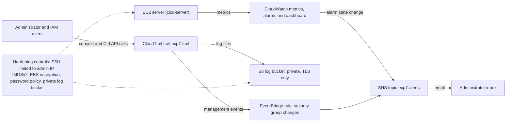

# Experiment 7: Cloud Monitoring, Logging, Auditing and Security Hardening

**Student:** Satwik Marne | **Course:** Cloud Computing and DevOps (Units 1 and 5) | **Region:** ap-south-1 (Mumbai)

## Problem
An organization has resources in the cloud but limited visibility into resource utilization, application health,
user activity and security configuration. The IT team needs to monitor resources, be alerted to abnormal conditions,
keep an audit trail of important activity, and reduce unnecessary exposure.

## Objective
Design and implement a monitoring, alerting, auditing and security-hardening solution for an AWS environment,
using the AWS CLI from the Windows command prompt, within the free tier.

## Architecture

## Services and justification

| Need | Service | Why |
|---|---|---|
| Resource monitoring | CloudWatch metrics and dashboard | EC2 publishes CPU, network and status metrics for free (5-minute basic monitoring) |
| Alerts | CloudWatch alarms and SNS email | An alarm turns a metric into a decision; SNS delivers it to the administrator |
| Audit trail | CloudTrail (multi-region trail to S3) | Records who did what and when; log file validation detects tampering |
| Security-change alerts | EventBridge rule to SNS | Near real-time email when a firewall rule changes |
| Log storage | S3 (private, public access blocked, TLS only) | Durable, cheap and locked down |
| Hardening | Security group, IMDSv2, EBS default encryption, IAM password policy | Reduces unnecessary exposure and unauthorized access |
| Automation | AWS CLI and JSON config files in this repo | Every step is repeatable and reviewable |

## Repository layout

| Path | Purpose |
|---|---|
| RUNBOOK.md | Step-by-step commands (run one at a time) with screenshot labels |
| config/ | JSON templates used by the commands (dashboard, bucket policy, SNS policy, EventBridge rule and target) |
| evidence/ | Screenshots, named by label |
| docs/ | Notes for the report |

Files ending in `.live.json` are generated from the templates with your account values and are not committed.

## Test cases

| ID | Test | Expected result |
|---|---|---|
| T1 | SNS email subscription | Subscription is confirmed (a full ARN, not PendingConfirmation) |
| T2 | CloudWatch alarms | exp7-cpu-high and exp7-status-check-failed exist and reach OK |
| T3 | Alert delivery | Forcing the alarm to ALARM sends an email |
| T4 | Dashboard | exp7-dashboard shows CPU, network, status and alarm widgets |
| T5 | CloudTrail logging | Trail is logging and log files appear in the S3 bucket |
| T6 | Audit lookup | lookup-events shows the user, event name and time of an action |
| T7 | Security change alert | Adding a security group rule sends an email |
| T8 | SSH hardening | Port 22 is open only to the administrator's IP |
| T9 | Host and account hardening | IMDSv2 required, EBS encryption by default on, password policy set |
| T10 | Log bucket protection | Public access blocked and a TLS-only policy in place |

## Cost notes
Basic EC2 metrics, a few alarms, email notifications, one multi-region CloudTrail trail and small S3 storage are free or
close to free within AWS allowances (check your account's plan). Stop the EC2 server when you are not working, and clean
up with the commands at the end of RUNBOOK.md.

## Limitations
No agent-based logs from inside the server, no centralized CloudWatch Logs search of CloudTrail events, and one
administrator inbox. These would be added in a larger environment.
